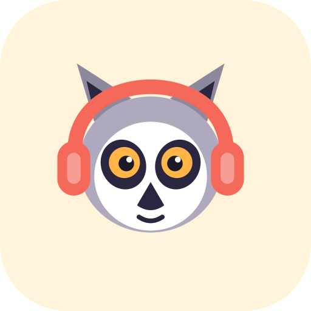
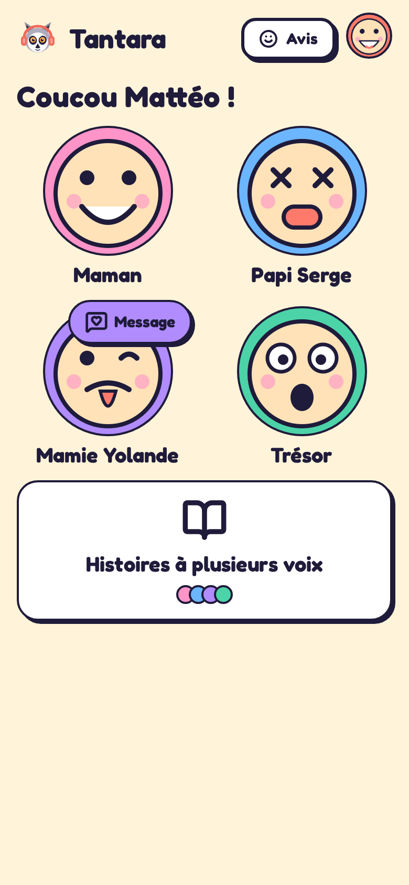
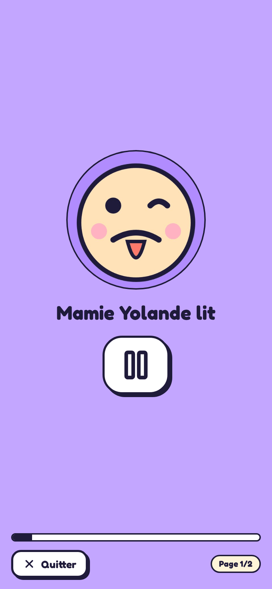
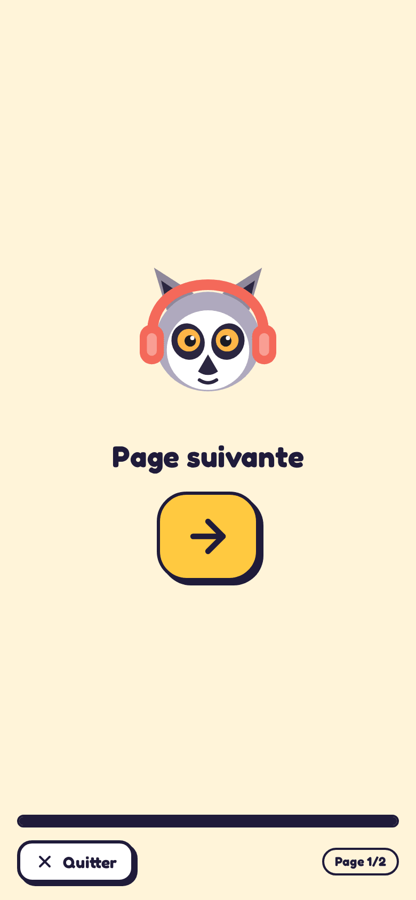
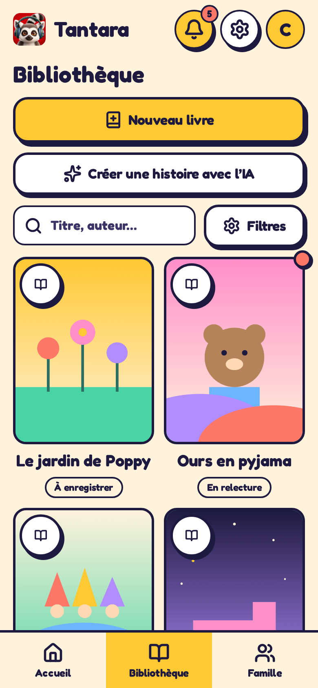
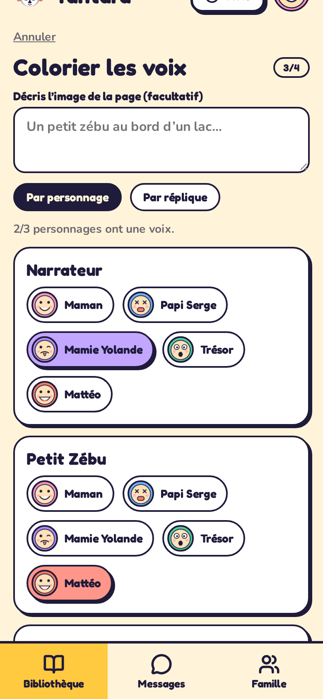
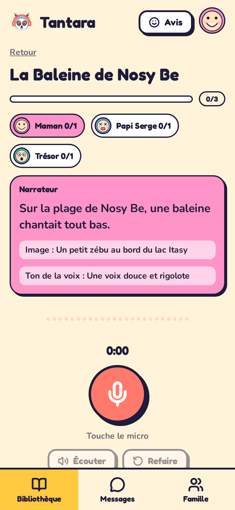
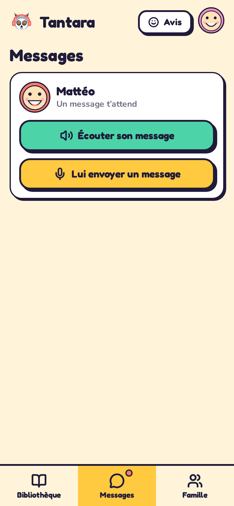
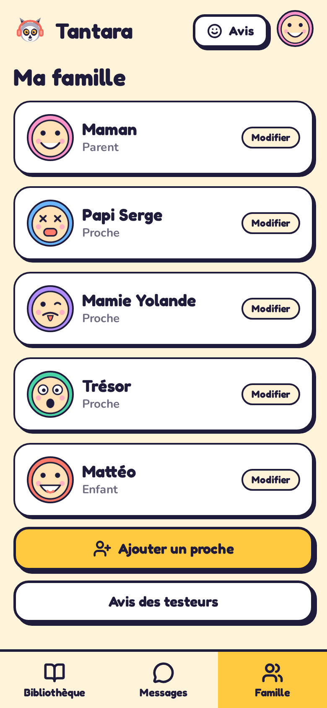
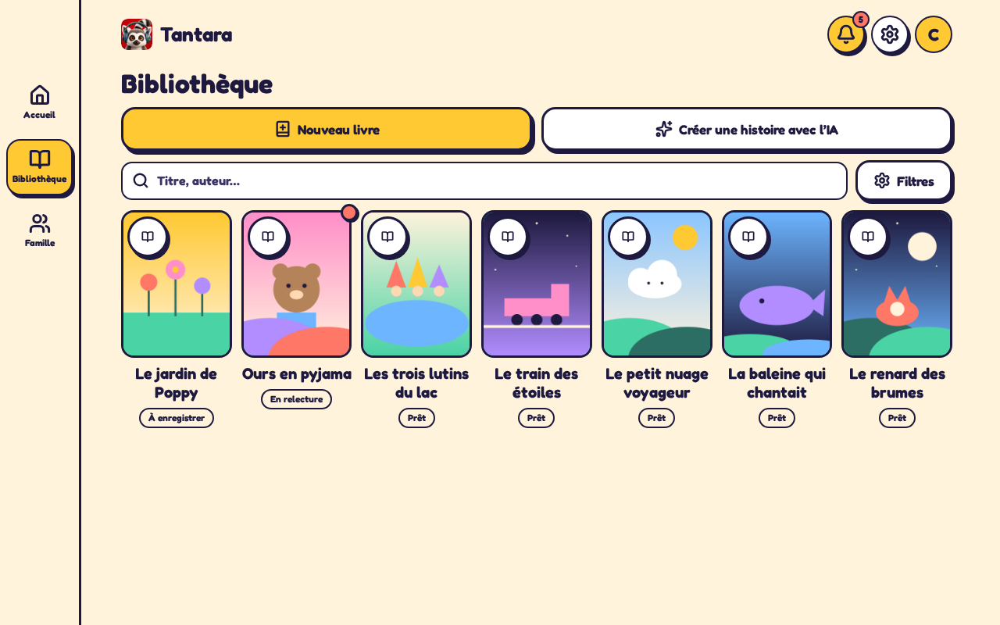

<p align="center">
    
</p>

<h1 align="center">Tantara</h1>

<p align="center">
    <strong>Paper books, read aloud by the people you love. Each voice has its own color.</strong>
</p>

Tantara turns the paper books already on your shelf into multi-voice audio stories. A parent photographs the pages and splits the lines, every relative gets a color and records their own lines from their phone, and the child listens book in hand. The screen never shows the text or the pictures of the book, only who is reading, in their color.

> Status: private family beta. It is meant to grow into a SaaS (real authentication, several families, invitations, subscription, OCR, native apps).

## Screens

| Child home | Player | Page turn |
| --- | --- | --- |
|  |  |  |

| Library | Color the voices | Recording studio |
| --- | --- | --- |
|  |  |  |

| Voice messages | Family |
| --- | --- |
|  |  |

The layout adapts from phones to desktops:



The UI is in French for now (the audience is a French-speaking family). Code, documentation, commits and repository metadata are in English.

## How it works

1. **Scan** the pages of a paper book (photos, private to the family) and type the lines by hand.
2. **Color the voices**: every character goes to a relative, per character or per line, with a tone per voice and a hint per sentence.
3. **Record** in the studio from any phone, line by line, with the picture description, tone and hint in view.
4. **Listen**: the child taps a face, hears the story, gets a soft "ding" and a "next page" screen at each page end.
5. **Message**: children and relatives exchange short voice messages (last five kept per conversation, listened once).

## Features

- Multi-voice casting with six voice colors and a mascot (a lemur with headphones)
- Screenless listening for children: faces, colors, icons and sounds only
- "Grimace" profile photos taken from the camera or picked from the gallery, so children recognize relatives
- Responsive design system (hard outlines, offset shadows, Fredoka and Nunito), animated Lucide icons, page transitions, reduced motion support
- Installable PWA (manifest, icons, service worker), Capacitor ready for iOS and Android
- Book model: subtitle, author, age range, language and type (standard, comic, wordless, child-written), characters defined once per book (one narrator at most), pages of kind cover, content or empty, comic panels, tone and scene description per line
- Recordings per line and language (draft, submitted, approved, changes requested, stale), line translations, and a recording turns stale when the text or tone of its line is edited
- Profile picker on every launch: every profile has its own code (4 to 6 digits, or 3 shapes out of 4 in order for children), checked server side with scrypt, per-profile lockout after 5 wrong tries, and the app returns to the picker on a cold start or after 30 seconds in the background
- Soft delete everywhere: nothing is ever hard deleted
- Simple server logs written in plain sentences, easy to read in Vercel logs
- End to end tests that run the whole product on a phone and a desktop viewport

## Profile codes

- A parent without a code creates one the first time the profile is selected. A child code (digits or shapes) is set by a parent, in the family screen.
- The session only changes profile after a verified code. A child session can never open a parent or relative profile, nor change anyone else code.
- Five wrong codes lock the profile for five minutes (persisted in `members`), whatever the session.
- The client clears the active profile on a cold start and after `PROFILE_IDLE_LOCK_MS` in the background (`app/utils/profile-lock.ts`).
- Biometrics plug in through `useProfileUnlockers` (see `IProfileUnlocker`), not implemented yet.

## Tech stack

| Area | Choice |
| --- | --- |
| Front | Nuxt 4 (SPA), Vue 3, TypeScript |
| Server | Nitro routes in `server/api`, bundled as a single file for Vercel |
| Data | PostgreSQL (Neon on Vercel) through the `postgres` driver, files stored as `bytea` |
| Icons | `lucide-vue-next` |
| Mobile | Capacitor |
| Tests | Playwright |
| Hosting | Vercel |

Project layout:

```
app/        Nuxt app: pages, components, composables, middleware, design system CSS
server/     API routes, database schema, session and request logging
shared/     Types and helpers shared by app and server
tests/e2e/  Playwright specs and helpers
docs/       GitHub Pages landing page and screenshots
design/     Original clickable prototypes (French) the UI was built from
```

## Getting started

Requirements: Node 22, pnpm, a PostgreSQL database.

```bash
pnpm install
cp .env.example .env
pnpm dev
```

### Environment

| Variable | Purpose |
| --- | --- |
| `DATABASE_URL` | PostgreSQL connection string |
| `SESSION_SECRET` | Mandatory. Signs the session cookies; sessions are refused (HTTP 500) when it is missing |
| `LEGACY_OWNER_EMAIL` | Optional. The account registered with this e-mail adopts the family created from pre-accounts data |
| `MAIL_MODE` | `capture` keeps mails in memory for tests (never in production) |
| `BREVO_API_KEY` and `MAIL_FROM` | Optional transactional mail provider used for code recovery |

The database schema is created and migrated on the first request. Accounts are created on `/register` (e-mail, password hashed with scrypt, one family and its first parent profile); every row belongs to a family and is only served to the accounts of that family.

### Scripts

| Command | Purpose |
| --- | --- |
| `pnpm dev` | Development server |
| `pnpm generate` | Static build in `.output/public` |
| `pnpm cap:sync` | Build and sync the Capacitor native projects |
| `pnpm exec nuxt typecheck` | Type check the app and the server |
| `pnpm exec playwright test` | Run the end to end suite |

### End to end tests

The suite starts its own dev server and database and runs twice, on a phone and on a desktop viewport, with a fake microphone and camera.

```bash
createdb tantara_e2e
pnpm exec playwright test
```

Run it against a deployed site (the suite registers its own accounts and soft deletes its test data afterwards):

```bash
E2E_BASE_URL=https://your-app.vercel.app \
    pnpm exec playwright test
```

### Mobile apps

```bash
pnpm exec cap add ios
pnpm exec cap add android
pnpm cap:sync
```

## Resumable audio upload

Audio is sent in 256 KB chunks so a dropped connection never loses a take. `POST /api/uploads` (size, mime) opens a session, `PATCH /api/uploads/:id` with an `Upload-Offset` header appends a chunk (a replayed chunk is accepted, a wrong offset answers 409 with the current offset), `GET /api/uploads/:id` returns the offset to resume from, `POST /api/uploads/:id/finish` assembles a `files` row (audio mime allowlist, 16 MB cap, family scoped) and `DELETE` aborts. Unfinished sessions expire after 24 hours. On the client, `useChunkedUpload` retries with backoff and resumes from the server offset; `useFiles.upload` uses it for audio and keeps the single request for images.

## Deployment

The project deploys on Vercel from the `main` branch. Connect a Postgres database (Neon integration), set the environment variables above, and push.

## Landing page

A static presentation page lives in `docs/` and is published with GitHub Pages (source: `main` branch, `/docs` folder).

## License

All rights reserved. This is a private project.
